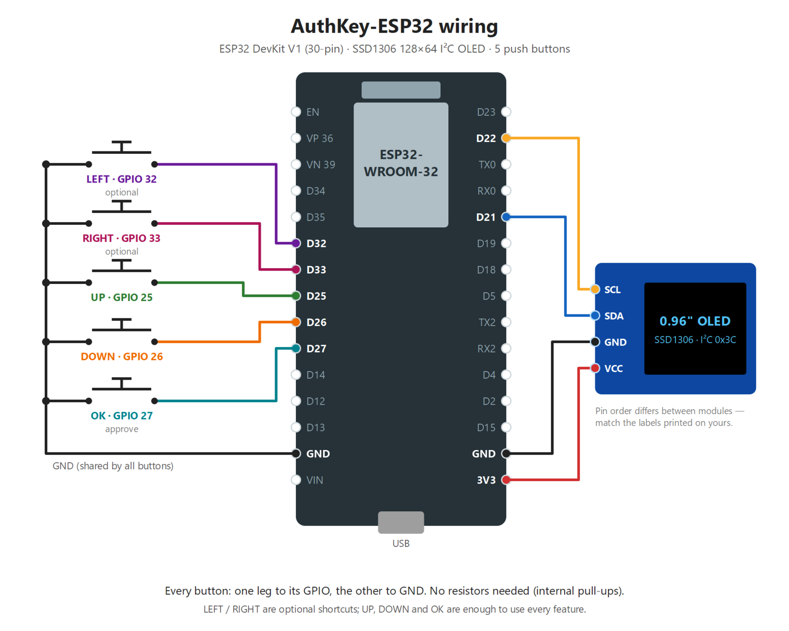

# AuthKey-ESP32

A standalone hardware authenticator on an ESP32 dev board with a 128×64 OLED and
a few buttons:

- **TOTP codes** (RFC 6238; SHA-1/256/512, 6 or 8 digits) shown on the OLED.
- **FIDO2 / passkey security key**: register and sign in to websites.
  - **Hybrid** (the "Use a phone or tablet" QR flow): works with Windows 11,
    Chrome and Edge. **No phone needed**: a small PC helper reads the QR off
    your screen and hands it to the device.
  - **Bluetooth security key** (CTAP over BLE): pair once, then pick
    "Security key". Works on Android, ChromeOS, Linux/macOS Chrome, and
    Windows 10 (Windows 11 support for BLE keys is inconsistent).
  - **USB security key** on Windows, through the PC service and usbip-win2.
- Every registration and sign-in is approved **on the device** with the OK
  button. An optional on-device PIN adds user verification.
- **Bluetooth keyboard**: press OK on a code to type it into the paired PC or
  phone.
- **Walk-away lock** for Windows (and Android, as a trusted device), plus
  automatic Windows sign-in when you come back.
- **Web page** on your network for the event log, campus login, passkeys and
  authenticator accounts.
- **Encrypted backups** of everything that can't be recreated.
- **Campus WiFi auto-login** (IIT Guwahati) for the whole network behind
  your router.

## Hardware

| Part | Notes |
| --- | --- |
| ESP32-WROOM-32 DevKit (4 MB) | CP2102 or CH340 USB bridge |
| 0.96" SSD1306 OLED, I²C | For a 1.3" SH1106, set `OLED_DRIVER` in `src/config.h` |
| 3–5 push buttons | Wired between GPIO and GND, using internal pull-ups |

| Signal | GPIO |
| --- | --- |
| OLED SDA / SCL | 21 / 22 (VCC → 3V3, GND → GND) |
| UP / DOWN / OK | 25 / 26 / 27 |
| LEFT / RIGHT (optional) | 32 / 33 |



**Windows driver:** if the board doesn't show up as a COM port, install the
[Silicon Labs CP210x driver](https://www.silabs.com/developer-tools/usb-to-uart-bridge-vcp-drivers)
(or the CH340 driver, depending on your board).

## Build & flash

```bash
cp .env.example .env                       # add your WiFi networks (and OTA password)
pio run -t upload                          # build + flash over USB
pio device monitor                         # serial console (type: help)
```

The first boot after upgrading from v1 changes the partition layout. Erase the
flash once with `pio run -t erase` before uploading.

WiFi is used for the clock (NTP), for hybrid sign-ins, and for optional OTA
updates. Without WiFi, TOTP still works once the clock is set (`time set <unix>`).

All secrets live in `.env` (git-ignored): `WIFI_<n>_SSID` / `WIFI_<n>_PASSWORD`,
`OTA_PASSWORD`, `OTA_HOST` and `IITG_USERNAME` / `IITG_PASSWORD` (campus
auto-login, below). `scripts/env_secrets.py` reads it at build
time, so nothing secret is kept in `src/`.

**Updates over WiFi, through the web page (recommended):**

```bash
pio run -e web -t upload                   # build, upload over WiFi, confirm twice on the AuthKey
python tools/webflash.py [--host <ip>] [firmware.bin]   # the same with an existing .bin
```

Or open the web page, allow the browser, and use the **Firmware** card. The
image is written to the spare app slot and checked (ESP32 header, SHA-256 and
an AuthKey tag, so a wrong `.bin` is refused). Nothing changes until you press
OK on the AuthKey, which shows the version it received (plus the device PIN,
if set). No USB means the PC helper keeps its Bluetooth link and the PC
doesn't lock. It also needs no inbound connection to the PC, so Windows
Firewall doesn't matter. Flash over USB once to get a firmware that has the
Firmware card.

**espota (ArduinoOTA):** set `OTA_PASSWORD` in `.env`, then
`pio run -e ota -t upload`. espota makes the device connect back to the PC,
which Windows Firewall usually blocks. Leave `OTA_PASSWORD` empty to keep it off.

## Using it

### Controls

| Where | Action |
| --- | --- |
| Home (TOTP) | UP/DOWN switch account · **OK types the code** (Bluetooth keyboard) · hold OK → menu |
| Menus | UP/DOWN move · OK select · hold OK (or LEFT) back |
| Passkey / pairing / backup / web prompt | **OK approve** · DOWN deny |
| PIN entry | UP/DOWN change digit · OK next digit · hold OK submit · hold UP delete |

The menu has: Passkeys (list/delete), Auto-approve, Device PIN, WiFi,
Campus net, Servers (wake-on-LAN), Remote (Telegram, web page), Bluetooth
(keyboard on/off, forget pairings), Event log, Device info (shows the web page
address), Reset passkeys.

### TOTP accounts

Add accounts over USB with the serial console, or with the helper script:

```bash
.venv/Scripts/python tools/authkey.py totp uri "otpauth://totp/GitHub:me?secret=JBSWY3DPEHPK3PXP&issuer=GitHub"
.venv/Scripts/python tools/authkey.py totp add "My Bank" JBSWY3DPEHPK3PXP
.venv/Scripts/python tools/authkey.py totp list
```

(`otpauth://` URIs are the text inside a site's QR code. Most authenticator
setup pages also show the secret as text.)

Easier: with the QR helper running (below) and the device on USB, just open
the site's "set up authenticator app" page. The helper spots the QR and adds
the account to the device by itself (once per QR); then type the code shown
on the OLED to finish the site's setup.

### Passkeys without a phone (hybrid, recommended on Windows 11)

1. Keep the device on WiFi and the PC's Bluetooth on.
2. Run the helper on the PC. To start it hidden at every login (shows as
   "AuthKey QR helper" in Task Manager, log in
   `%LOCALAPPDATA%\AuthKey\qr_bridge.log`):

   ```powershell
   pc\build.ps1                                                    # builds pc\bin\AuthKeyQR.exe
   powershell -ExecutionPolicy Bypass -File tools\autostart.ps1    # -Remove to undo
   ```

   Or run it in a terminal: `.venv/Scripts/python tools/qr_bridge.py`.

3. On a website, choose to create or use a passkey, then
   **"Use a phone or tablet" / "iPhone, iPad or Android device"**.
   Windows shows a QR code. The helper spots it and sends it to the device over
   USB, or over Bluetooth if the device isn't plugged in.
4. The device connects through the FIDO tunnel and shows **REGISTER** or
   **SIGN IN** with the site name. Press **OK**.

### Type codes with the Bluetooth keyboard

The device is also a Bluetooth keyboard. Pair **AuthKey-ESP32** with your PC
or phone (the OLED shows a 6-digit code: press OK if it matches), click into
the code field, then press **OK** on the code screen: the device types the
current code. It types into every paired host that is connected. Turn the
keyboard off (or on) in **Menu → Bluetooth → OK**; the device restarts.

If the PC was paired before the keyboard existed, remove AuthKey-ESP32 in
Windows Bluetooth settings and pair it again, so Windows picks up the keyboard.

On Android a connected hardware keyboard hides the on-screen keyboard. To
keep it, turn on Settings → System → Keyboard → Physical keyboard →
*Show on-screen keyboard*.

### Passkeys over Bluetooth (security-key mode)

Pair "AuthKey-ESP32" in your OS Bluetooth settings. The OLED shows a 6-digit
code; press OK if it matches the PC. Then choose "Security key" when a site
asks for a passkey.

### Passkeys over USB ("Security key" on Windows)

With the Windows service installed (see *Windows sign-in* below) and
[usbip-win2](https://github.com/vadimgrn/usbip-win2/releases) installed, the
plugged-in AuthKey also shows up as a normal USB FIDO security key. When a site
asks for a passkey, pick **Security key**. The service presents a virtual
USB HID key over USB/IP on 127.0.0.1 and forwards each CTAP request to the
device over its serial port. The key attaches when the board is plugged in
and detaches when it's unplugged. To turn it off, create
`C:\ProgramData\AuthKey\no-virtual-key` and restart the service.

### Firefox

Firefox on Windows uses the same Windows passkey dialog as Chrome and Edge,
so everything above works the same: **Security key** (Bluetooth or USB) and
**"Use a phone or tablet"** (the QR helper spots the QR in any browser).

### Android

Pair AuthKey-ESP32 with the phone (it pairs as a keyboard; press OK on the
AuthKey when the codes match), then install the companion app in `android/`:

```bash
cd android
./gradlew assembleDebug        # needs JDK 17 (Android Studio's, or set JAVA_HOME)
adb install -r app/build/outputs/apk/debug/app-debug.apk
```

The app (Kotlin, Android 9+):

- **Passkeys, Android 14+:** turn on AuthKey under *Passkey provider
  settings*. Android's passkey sheet (Chrome, apps) then offers **AuthKey
  security key**. The app talks CTAP to the AuthKey over **Bluetooth**, or
  over **USB** when it's plugged into the phone (USB-C/OTG cable, CP2102
  boards). You approve on the AuthKey as usual. Android reserves the standard
  FIDO Bluetooth service for its system apps, so the firmware offers the same
  channel on its own service (`A3C87504/05`), encrypted links only.
- **Passkeys via QR, any version:** like the Windows helper, a passkey QR
  ("Use a phone or tablet" / "Use another device") makes the AuthKey sign in
  the way a phone would (over its WiFi). Point the app's camera at a QR on any
  computer or phone. For a QR on the phone's own screen, use the **AuthKey
  QR** Quick Settings tile, or share a screenshot to AuthKey. Authenticator
  (`otpauth://`) QRs are added to the AuthKey's codes when it is on USB.
- **Walk-away lock:** locks the phone after the AuthKey has been out of range
  for 15 s (configurable), with the same rules as on Windows: it only locks
  after seeing the AuthKey nearby, and unlocking with your PIN while it's
  away doesn't lock again. Two lock methods; turn on one:
  *Normal* (Accessibility) locks like the power button, so fingerprint still
  works; *Strict* (device admin) needs the PIN after each lock. On Android 13+,
  sideloaded apps need App info → ⋮ → *Allow restricted settings* first.
- **Keep running:** the lock runs as a service with a permanent
  notification. The app asks to be excluded from battery optimisation.
  Samsung phones also need Settings → Battery → Background usage limits →
  *Never sleeping apps* → AuthKey.

Without the app, Android's own **Extend Unlock → Trusted devices** (Smart
Lock) can keep the phone unlocked while the AuthKey is connected, and the
keyboard types TOTP codes into apps too.

### Device PIN (user verification)

Set a 4–8 digit PIN in **Menu → Device PIN**. Sites that ask for user
verification then make you enter the PIN on the device. After 8 wrong
attempts, user verification is blocked until you reset the passkeys.

### Windows sign-in (unlock the PC)

The device can sign you in to Windows: wake the lock screen and, if the
AuthKey is reachable, you're signed in without a PIN, face or password.
It works over **USB, Bluetooth and WiFi**, whichever answers first.

```powershell
pc\build.ps1                      # builds pc\bin (Visual Studio C++ tools + .NET 9 SDK)
# then, in an Administrator PowerShell, with the device on USB:
pc\install.ps1                    # installs, pairs (press OK on the device), tests
```

Pairing asks for your Windows account **password**. For a Microsoft account
that's the account.microsoft.com password, not the Hello PIN. It is stored
encrypted (DPAPI) in `C:\ProgramData\AuthKey`, readable only by SYSTEM and
Administrators, and is released to the lock screen only after the device
answers a fresh random challenge (HMAC-SHA256 with a per-PC key).

- With auto-approve **on**, the device answers by itself. With it **off**, the
  OLED asks "UNLOCK PC?" and you press OK.
- USB means "unlocked whenever plugged in". WiFi works whenever the device is
  on the same network. Bluetooth works within about 10 m. Turn
  transports on or off with
  `"C:\Program Files\AuthKey\AuthKeyUnlock.exe" set usb|bluetooth|wifi on|off`.
- Your normal PIN, face and password sign-in stay available. If Windows ever
  rejects the stored password (e.g. you changed it), automatic sign-in pauses;
  sign in normally and run `AuthKeyUnlock.exe pair` again.
- Log: `C:\ProgramData\AuthKey\logs\service.log` (readable without admin).
  For a per-packet USB key trace, create `C:\ProgramData\AuthKey\vk-trace`.
- Emergency off-switch: create the file `C:\ProgramData\AuthKey\disabled`.
  Remove everything with `pc\uninstall.ps1 -Purge`.

### Lock the PC when you walk away

The PC helper (the one that reads QR codes, `tools/qr_bridge.py`) watches
the AuthKey's Bluetooth signal; the device advertises all the time, even while
connected. When the AuthKey has been out of range for 20 s, the PC locks,
as if you pressed Win+L. Come back and the AuthKey signs you in again
(*Windows sign-in* above).

- It only locks after it has seen the AuthKey nearby, and each lock disarms
  it until the AuthKey is nearby again. So if you sign in with your Windows
  PIN while the AuthKey is away, the PC stays unlocked (no lock loop) until
  the AuthKey comes back.
- Settings in `%LOCALAPPDATA%\AuthKey\helper.json`: `auto_lock`,
  `away_seconds` (20), `min_rssi` (-85 dBm: a weaker signal counts as away;
  raise it towards -70 to lock sooner). Restart the helper after editing
  (`tools\autostart.ps1`). `python tools/presence.py watch` shows the live
  signal without locking. `qr_bridge.py --no-lock` turns it off.
- Flashing the device over USB takes it off the air for about a minute, so
  the PC locks; sign in with your PIN (the lock won't loop).

### Campus WiFi auto-login (IITG)

IIT Guwahati's firewall (`agnigarh.iitg.ac.in:1442`) signs you out after a
while unless the login page is kept open. With `IITG_USERNAME` /
`IITG_PASSWORD` in `.env`, the device does that job for the whole network
behind your router:

- Every 2 min it checks the internet. If it's down, it logs in (it fetches a
  fresh form from `/login?` and posts it, as the browser does). If it's up
  through someone else's login, it takes the session over so it can keep it.
- It refreshes its session every 20 min (`/keepalive`), well inside the
  30-min window, so the network never drops.
- The portal's certificate is verified (DigiCert root), so the password is
  only ever sent to the real portal. It is never logged.
- "Session limit" replies make it wait and retry every 5 min until a slot is
  free. Rejected logins back off to every 30 min after 3 tries (no lockout).
- If NTP is blocked while logged out, the clock is taken from the HTTP `Date`
  header.

**Menu → Campus net** shows the state, last result and refresh countdown,
and has **Login now**, **Logout** (pauses auto-login until you log in
again) and the **Auto-login ON/off** switch. The home screen shows
`IITG ✓ 14m` next to the clock while online (14 min to the next refresh),
`!NET` while the network needs a login and `IITG-` while paused. Serial:
`portal status|login|logout|on|off`. Every login, drop and failure is in the
event log with its time (`14:39 IITG session lost`), so you can see when and
how often the campus ends sessions.

The PC helper shows a Windows notification when the campus internet drops,
comes back, or the login is stuck (session limit, rejected password). If
Windows notifications are turned off (Settings → System → Notifications), it
shows a small pop-up that closes itself instead. `qr_bridge.py --no-notify`
turns this off.

### Wake-on-LAN machines and the Telegram remote

The device wakes machines on the LAN (Proxmox `pve` by default) and tells you
when they are up. A Telegram bot controls it and the rest of the AuthKey. It
polls Telegram, so nothing has to be reachable from the internet.

**Machines.** Up to 8, each with a name, MAC, IP (optional: only needed for
status checks), the TCP ports to check (default 8006, then 22), an optional
directed broadcast, and its own auto-wake switch. Add them in `.env`
(`WOL_1_NAME`, `WOL_1_MAC`, `WOL_1_IP`, `WOL_1_PORTS`, `WOL_1_BROADCAST`,
then `WOL_2_…`; see `.env.example`), or later from Telegram (`/addhost`),
the web page (Servers card), the OLED (Menu → Servers) or the console
(`wol add`). One global switch (`/wol off`) stops all packets and auto-wake.

- **Wake:** magic packet (6× `FF` + 16× MAC, UDP 9) to 255.255.255.255, the
  machine's broadcast and the WiFi subnet's broadcast, 3 times 1 s apart.
  Then it checks every 10 s and reports 🟢 when it's up, or 🔴 after 3 min.
- **Status:** TCP connect to the machine's ports (more reliable than ping).
- **Monitor:** every machine with an IP is checked about once a minute.
- **Alerts** (per machine, on by default): "🔴 pve went down" after 2 missed
  checks in a row (about 2 min), "🟢 pve is back up (it was down 8 min)" on
  the next answer. Only real changes are reported, never the first state
  after a boot. They are muted by `/notify off`.
- **Auto-wake** (per machine, **off by default** so it doesn't fight a
  deliberate shutdown): wake it when it has been unreachable for N minutes
  (default 10; 5 / 10 / 30 / 60 are buttons). At most 3 tries, then it waits
  until the machine is seen up again.
- **Pause** (`/pause pve 2h`, or the button): no alerts and no auto-wake
  until then. `up` pauses until it is seen up again. A shutdown from Telegram
  (`/pve shutdown`) does that by itself and tells you when it is off.
- **Maintenance windows** (weekly, up to 2 per machine, local time, e.g.
  `sat 00:00 120` for the weekly updates and `sun 00:00 120` for the backup):
  - 5 min before the window, the machine is woken if it is off, so the
    scheduled job runs. Switch this off with the "Wake before maintenance"
    button or `/maint pve wake off`.
  - Restarts inside the window don't alert, and auto-wake waits until it ends.
  - When the window ends you get a summary: up or down, and how often it
    restarted. With Proxmox set up it also lists the backups that ran in the
    window (✅ / ⚠️ / ❌ and how long they took), pending host updates, and
    whether the host rebooted.

  Set them in `.env` (`WOL_1_MAINT=sat 00:00 120; sun 00:00 120`), with
  `/maint`, the web page (**Maint…**) or `wol maint`.

**Telegram commands** (`/menu` shows them as buttons; Telegram also lists
them when you type `/`):

| Command | What it does |
| --- | --- |
| `/wake [machine\|all]` | Wake, then report when it's up |
| `/status [machine\|all]` | 🟢 up / 🔴 down |
| `/hosts` | Machines and their last state; tap one for its screen |
| `/host <machine>` | One machine's screen: Wake, Check, auto-wake on/off and delay, alerts, pause / resume, wake before maintenance (the buttons edit the message in place) |
| `/autowake <machine\|all> on\|off [min]` | Auto-wake per machine |
| `/pause <machine\|all> [2h\|30m\|1d\|up\|off]` | Pause auto-wake and alerts (default 2 h) |
| `/alerts <machine\|all> on\|off` | Down / back-up alerts |
| `/maint [<machine> add <days> <HH:MM> <min> \| clear \| wake on\|off]` | Weekly maintenance windows |
| `/pve [machine] [shutdown\|reboot\|cert\|unpin]` | Proxmox: status, guests, last backups, pending updates, power (below) |
| `/vm [machine] [<id> start\|shutdown\|reboot\|stop]` | Proxmox VMs and containers, with buttons |
| `/addhost <name> <mac> [ip] [ports] [broadcast]` | Add or replace a machine |
| `/sethost <machine> ip\|mac\|ports\|broadcast\|name <value>` | Change one field (e.g. a new DHCP address) |
| `/delhost <machine>` · `/wol on\|off` | Remove a machine · the global switch |
| `/info` · `/log [n]` | Device status (WiFi, campus, Bluetooth, RAM…) · event log |
| `/portal [login\|logout\|on\|off]` | Campus internet login |
| `/set [switch on\|off]` | Switches: campus auto-login, wake-on-LAN, auto-approve, keyboard, web page |
| `/notify off\|important\|all` | Push notifications for events (default: important = boots, campus drops, sign-ins, PIN / pairing / backup changes) |
| `/totp` · `/code <account>` | Account names · a TOTP code (only if allowed on the device) |
| `/hybrid <FIDO:/…>` | Passkey sign-in from a QR's text |
| `/cmd <console command>` | Run any console command and get its output |
| `/reboot` · `/help` | |

**Security rules:**

- Only the chat IDs in `.env` get answers; other chats are ignored and logged.
- Commands that weaken protection, inject input, reach secrets or erase
  evidence need **OK pressed on the AuthKey** when they come from Telegram:
  turning auto-approve on, deleting passkeys or paired PCs, forgetting
  Bluetooth, raw CTAP, backup / restore, keyboard typing, `hybrid`, clearing
  the log, changing the clock, longer PIN sessions.
- TOTP codes are never sent unless you allow it **on the device** (Menu →
  Remote → TG codes). Telegram can't switch that on, because whoever reads
  the chat would hold your second factor.
- Commands older than 2 minutes (sent while the AuthKey was off) are ignored,
  so a stale `/wake` never starts a machine later.

**Device screens:** Menu → **Servers** lists the machines (UP / down / ?).
OK on one gives Wake, Check now, Auto-wake on/off, Alerts on/off and Pause
2 h / Resume. The last row is the global switch. Menu → **Remote** shows the bot's state and switches the
notification level, TOTP codes over Telegram and the web page.

**Setup:**

1. Create a bot with [@BotFather](https://t.me/BotFather) and put its token in
   `.env` as `TELEGRAM_BOT_TOKEN=`. Leave `TELEGRAM_CHAT_ID=` empty and flash.
2. Send your bot any message. With no chat ID set, the device only logs the
   sender's chat ID (serial: `[TG] chat ID 123456789 ...`, and the event log).
3. Put that number in `.env` as `TELEGRAM_CHAT_ID=` (comma-separate several)
   and flash again. Send `/menu`.

Console (USB): `wol [list]`, `wol add <name> <mac> [ip|-] [ports] [broadcast]`,
`wol del|wake|check <machine>`, `wol auto <machine> on|off [min]`,
`wol alerts <machine> on|off`, `wol pause <machine> 2h|up|off`,
`wol maint <machine> add sat 00:00 120|clear|wake on|off`, `pve [machine]`,
`pve guests|cert [machine]`, `pve unpin <machine>`,
`wol on|off`, `wol reset` (back to `.env`), `tg`, `tg ping` (a verified TLS
connection to Telegram, no token needed) and `tg sim <command>`, which runs a
bot command and prints the reply here (testing without Telegram).

The Telegram certificate is verified against Go Daddy Root G2. A failed check
is logged (`TG cert check failed`) and never bypassed. The campus network
passes Telegram through without TLS inspection. Only one TLS connection fits
in RAM next to Bluetooth, so the bot hangs up just before the campus portal's
refresh or login and during hybrid sign-ins, then reconnects. A task
watchdog reboots the device if the main loop ever stalls for 60 s.

RAM is the tight resource: a TLS session peaks at ~54 KB and the core's
mbedTLS has fixed 16 KB buffers. The hybrid sign-in's ~7 KB of buffers are
allocated only while a session runs, so the bot and the portal have room. When the heap runs short, mbedTLS reports it
as "certificate verification failed", so `mem` (free heap, largest block,
loop-stack use) and `tlstest` (a verified connection to the hybrid tunnel
server, with the chain and mbedTLS's reason on failure) are there to tell
the two apart.

#### Proxmox

With an API token the bot also talks to Proxmox VE directly:

- `/pve`: uptime, Proxmox version, CPU, load, RAM, disk, every VM and
  container (running or not), the last backups, pending updates and the next
  maintenance window, with buttons for Refresh, Guests, Shut down and Reboot.
- `/vm`: guests as buttons. Each one offers Start, Shut down, Reboot and Stop.
- Shut down, reboot and stop need a second tap on a "Yes" button. The button
  only works for that one action, for 2 minutes. After a shutdown, auto-wake
  and alerts pause until the machine is up again, and the bot tells you once
  it is off. After a reboot it reports when it is back, or says so if it
  isn't back within 20 min.
- At the end of each maintenance window: the backup results, update status
  and whether the host restarted.

Setup, in the Proxmox web UI or a root shell on the host:

1. Create a token: Datacenter → Permissions → API Tokens → Add (user
   `root@pam`, token ID e.g. `esp32`). Keep **Privilege Separation** ticked:
   the token then has only the rights you give it below, not root's.
2. Give it a role with exactly what the bot uses:

   ```bash
   pveum role add AuthKey -privs "Sys.Audit Sys.PowerMgmt VM.Audit VM.PowerMgmt"
   pveum acl modify / -token 'root@pam!esp32' -role AuthKey
   ```

   The UI way: Datacenter → Permissions → Roles → Create, then Permissions →
   Add → API Token Permission, path `/`, role `AuthKey`. Leave
   `Sys.PowerMgmt` / `VM.PowerMgmt` out for a read-only bot.
3. In `.env`: `PROXMOX_TOKEN_ID=root@pam!esp32`, `PROXMOX_TOKEN=<the secret>`,
   `PROXMOX_HOST_IP`, `PROXMOX_HOST_PORT` (8006), and optionally
   `PROXMOX_HOST_URL` (a link shown under `/pve`, e.g. a Cloudflare tunnel).
   See `.env.example`. Flash, then send `/pve`.

No password is needed or stored, only the token. Proxmox's certificate is
self-signed, so it is **pinned** instead of checked against a CA: either
`PROXMOX_FINGERPRINT` (SHA-256, from node → System → Certificates), or the
certificate seen on the first connection, stored on the device (`/pve cert`
shows it, so you can compare it with the Proxmox UI). Any other certificate
is refused before the token is sent. After renewing the certificate, run
`/pve unpin`, which needs OK on the AuthKey. A Proxmox call takes a few
seconds and briefly closes the Telegram connection, because only one TLS
session fits in RAM.

**Server BIOS (F2 at boot), needed for this to work:**

- Power Management → **AC Recovery = Power On**: the server comes back by
  itself after a power cut.
- **Deep Sleep Control = Disabled**: otherwise the NIC is fully off and
  wake-on-LAN can't work.
- **Wake on LAN/WLAN = LAN Only**.

If `/wake` does nothing, test from a laptop on the same WiFi to see whether
the device or the network is the problem:

```powershell
$mac = [byte[]](0x64,0x00,0x6a,0x2b,0x36,0x9f)
$pkt = [byte[]]((,0xFF * 6) + ($mac * 16))
$udp = New-Object Net.Sockets.UdpClient; $udp.EnableBroadcast = $true
foreach ($ip in '255.255.255.255','172.16.119.255') { [void]$udp.Send($pkt, $pkt.Length, $ip, 9) }
```

If that doesn't wake it either, the WiFi access point may be dropping
broadcasts towards the wired side. Then use a wired ESP32 (WT32-ETH01,
Olimex ESP32-POE) on the same LAN.

### Web page

`http://authkey-esp32.local/` (or the IP shown in **Menu → Device info**)
from any browser on the same network, phones included:

- Anyone on the network sees only the device status and campus-login state.
- **Allow this browser** shows "ALLOW WEB ACCESS?" on the OLED; press OK.
  For 12 hours that browser gets the event log, campus Login/Logout and the
  auto-login switch, the passkey and authenticator lists (delete, add an
  `otpauth://` link), the phone sign-in box, the wake-on-LAN machines (Wake,
  Check, auto-wake, alerts, Pause 2 h, maintenance windows) and the
  **Firmware** card (see Build & flash). Sessions live in RAM, are tied to the
  browser's IP and end on reboot or with **Lock this browser**.
- Codes and secrets are never shown on the page.

### Backup and restore

Every passkey is derived from a master key inside the device: if the board
dies, they're gone. Make a backup once, and again after adding passkeys or
accounts:

```bash
.venv/Scripts/python tools/authkey.py backup authkey-backup.json
.venv/Scripts/python tools/authkey.py restore authkey-backup.json   # onto a new or reset board
```

The backup holds the master key, passkey records, signature counter, TOTP
accounts and paired PCs. It is encrypted with AES-256-GCM under a key made
from your passphrase (PBKDF2-SHA256, 600 000 rounds). Only that derived key
goes over USB, never the passphrase. Both directions must be confirmed on the
OLED, with the device PIN if one is set. Restoring replaces everything,
moves the signature counter forward (so sites never see it go back) and
restarts the device. Keep the file and the passphrase in separate places.

**Reminder:** about once an hour the device compares a fingerprint of what a
backup would hold (without the sign counter) with the one saved at the last
export. If passkeys, accounts or paired PCs changed (for a day), or the last
backup is older than 30 days, the Telegram bot reminds you, at most once a
week. `status` (and `/info`) shows the state: `Backup: 3 days ago, up to date`.

### Event log

**Menu → Event log**, `log` on the serial console, or the web page. Each line
is stamped with the time (or `+M:SS` since boot before the clock is set). The
log survives reboots, crashes and power cuts. Each boot logs why the last one
ended (`Boot v2.1.0 (crash)`, `(power on)`, `(restart)`). `log clear` empties it.

## Serial console

`help` lists everything. Highlights: `status`, `totp …`, `wifi add <ssid> <pass>`,
`passkeys`, `tz <POSIX TZ>`, `auto on|off`, `hybrid <FIDO:/…>`, `portal …`,
`log`, `log clear`, `kbd`, `kbd on|off`, `kbd type <n>`.

## Security notes

- Private keys are never stored. Each credential ID is MAC-protected and binds
  a random nonce to the site, and the key is re-derived from a 32-byte device
  master key. Discoverable passkeys store only the user name/ID for listing.
- The master key lives in NVS flash **unencrypted**. Someone with physical
  access could dump the flash and clone your keys. ESP32 flash encryption and
  secure boot would fix this, but they burn eFuses irreversibly, so they're
  left to you.
- **Auto-approve** (off by default) makes sign-ins and passkey registrations
  hands-free: no button press. If a device PIN is set, sites that require
  user verification (Google, Microsoft, ...) ask for the PIN **once**; the
  device then stays *unlocked* for 12 hours (`uvhours <n>`, 0 = until reboot)
  and verifies hands-free, like an unlocked phone. `lock` ends the session.
  Without a PIN the device reports "not verified", which works for sites that
  only *prefer* verification, but Google then treats the key as a
  2-Step-Verification-only key. With the QR helper running, any site asking
  for this passkey on your PC gets signed in while the device is unlocked.
- OTA is **off** unless `OTA_PASSWORD` is set in `.env`. Anyone who can flash
  firmware can read your keys, so use a long random password and trusted WiFi.
- Firmware upload from the web page needs an approved browser session **and**
  OK (plus the device PIN, if set) on the AuthKey, after it shows the
  version. The image isn't signed (that needs secure boot), so only confirm an
  update you started yourself.
- The Proxmox token sits in the firmware like the Telegram token. Give it
  only the role above. The certificate pin means a machine pretending to be
  `pve` never gets the token.
- The `test` build (`pio run -e test`) adds console commands that let software
  on the PC approve requests (`approve!` even skips the PIN for backup
  prompts). Use it only for running the tests.
- The web page is plain HTTP on your local network: an approved browser
  session could be sniffed by someone else on the same WiFi. It never shows
  codes or secrets, but it can delete passkeys and log the campus session
  out. Lock the browser session when you're done on a shared network.

## Tests

With the **test** build flashed:

```bash
python -m venv .venv
.venv/Scripts/pip install fido2 pyserial cryptography websockets bleak pyotp cbor2
.venv/Scripts/python tools/test_device.py     # CTAP2 + TOTP, verified by python-fido2's RP server
.venv/Scripts/python tools/hybrid_sim.py      # full hybrid flow via the real tunnel + PC Bluetooth
```

Flash the normal build afterwards: `pio run -t upload`.

## Layout

```text
src/
  main.cpp               setup + cooperative main loop
  config.h               pins and constants (secrets: .env via scripts/env_secrets.py)
  core/                  event log (persistent), settings, PIN, on-device approvals, backup
  crypto/                mbedTLS wrappers (P-256, AES-GCM, HKDF, ...)
  util/                  CBOR reader/writer, hex/base32, FIDO QR digits
  fido/                  CTAP 2.0 engine, credential derivation & storage
  transport/ble.*        NimBLE: FIDO BLE service, keyboard, pairing, hybrid adverts
  transport/hybrid.*     caBLE v2: tunnel, Noise KNpsk0, encrypted CTAP
  net/                   WiFi/NTP/OTA, campus portal login, web page (+ firmware upload), Telegram bot, wake-on-LAN + monitor, Proxmox API, root CAs
  totp/                  TOTP storage and generation
  ui/                    OLED screens, buttons
  cli/                   USB serial console
tools/                   PC helpers (QR, walk-away lock, notifications, backup, WiFi flashing) and tests
android/                 Android app (Kotlin): passkeys over BLE/USB, QR, walk-away lock
partitions.csv           2 × 1.875 MB OTA slots + 128 KB NVS
```
