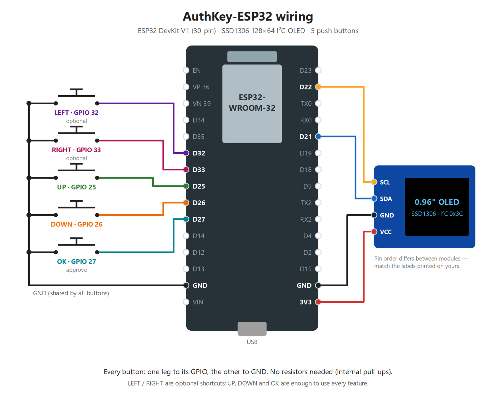

# AuthKey-ESP32

A standalone hardware authenticator on an ESP32 dev board with a 128×64 OLED and
a few buttons:

- **TOTP codes** (RFC 6238; SHA-1/256/512, 6 or 8 digits) shown on the OLED.
- **FIDO2 / passkey security key**: register and sign in to websites.
  - **Hybrid** (the "Use a phone or tablet" QR flow): works with Windows 11,
    Chrome and Edge. **No phone needed**: a small PC helper reads the QR off
    your screen and hands it to the device.
  - **Bluetooth security key** (CTAP over BLE): pair once, then pick
    "Security key". Works on Android, ChromeOS, Linux/macOS Chrome, and
    Windows 10 (Windows 11 support for BLE keys is inconsistent).
  - **USB security key** on Windows, through the PC service and usbip-win2.
- Every registration and sign-in is approved **on the device** with the OK
  button. An optional on-device PIN adds user verification.

## Hardware

| Part | Notes |
| --- | --- |
| ESP32-WROOM-32 DevKit (4 MB) | CP2102 or CH340 USB bridge |
| 0.96" SSD1306 OLED, I²C | For a 1.3" SH1106, set `OLED_DRIVER` in `src/config.h` |
| 3–5 push buttons | Wired between GPIO and GND, using internal pull-ups |

| Signal | GPIO |
| --- | --- |
| OLED SDA / SCL | 21 / 22 (VCC → 3V3, GND → GND) |
| UP / DOWN / OK | 25 / 26 / 27 |
| LEFT / RIGHT (optional) | 32 / 33 |



**Windows driver:** if the board doesn't show up as a COM port, install the
[Silicon Labs CP210x driver](https://www.silabs.com/developer-tools/usb-to-uart-bridge-vcp-drivers)
(or the CH340 driver, depending on your board).

## Build & flash

```bash
cp .env.example .env                       # add your WiFi networks (and OTA password)
pio run -t upload                          # build + flash over USB
pio device monitor                         # serial console (type: help)
```

The first boot after upgrading from v1 changes the partition layout. Erase the
flash once with `pio run -t erase` before uploading.

WiFi is used for the clock (NTP), for hybrid sign-ins, and for optional OTA
updates. Without WiFi, TOTP still works once the clock is set (`time set <unix>`).

All secrets live in `.env` (git-ignored): `WIFI_<n>_SSID` / `WIFI_<n>_PASSWORD`,
`OTA_PASSWORD`, `OTA_HOST` and `IITG_USERNAME` / `IITG_PASSWORD` (campus
auto-login, below). `scripts/env_secrets.py` reads it at build
time, so nothing secret is kept in `src/`.

**Updates over WiFi (OTA):** set `OTA_PASSWORD` in `.env`, flash once over
USB, then update wirelessly with `pio run -e ota -t upload` (password and
host come from `.env`). Leave `OTA_PASSWORD` empty to keep OTA off.

## Using it

### Controls

| Where | Action |
| --- | --- |
| Home (TOTP) | UP/DOWN switch account · hold OK → menu |
| Menus | UP/DOWN move · OK select · hold OK (or LEFT) back |
| Passkey / pairing prompt | **OK approve** · DOWN deny |
| PIN entry | UP/DOWN change digit · OK next digit · hold OK submit · hold UP delete |

The menu has: Passkeys (list/delete), Auto-approve, Device PIN, WiFi,
Bluetooth (forget pairings), Event log, Device info, Reset passkeys.

### TOTP accounts

Add accounts over USB with the serial console, or with the helper script:

```bash
.venv/Scripts/python tools/authkey.py totp uri "otpauth://totp/GitHub:me?secret=JBSWY3DPEHPK3PXP&issuer=GitHub"
.venv/Scripts/python tools/authkey.py totp add "My Bank" JBSWY3DPEHPK3PXP
.venv/Scripts/python tools/authkey.py totp list
```

(`otpauth://` URIs are the text inside a site's QR code. Most authenticator
setup pages also show the secret as text.)

Easier: with the QR helper running (below) and the device on USB, just open
the site's "set up authenticator app" page. The helper spots the QR and adds
the account to the device by itself (once per QR); then type the code shown
on the OLED to finish the site's setup.

### Passkeys without a phone (hybrid, recommended on Windows 11)

1. Keep the device on WiFi and the PC's Bluetooth on.
2. Run the helper on the PC. To start it hidden at every login (shows as
   "AuthKey QR helper" in Task Manager, log in
   `%LOCALAPPDATA%\AuthKey\qr_bridge.log`):

   ```powershell
   pc\build.ps1                                                    # builds pc\bin\AuthKeyQR.exe
   powershell -ExecutionPolicy Bypass -File tools\autostart.ps1    # -Remove to undo
   ```

   Or run it in a terminal: `.venv/Scripts/python tools/qr_bridge.py`.

3. On a website, choose to create or use a passkey, then
   **"Use a phone or tablet" / "iPhone, iPad or Android device"**.
   Windows shows a QR code. The helper spots it and sends it to the device over
   USB, or over Bluetooth if the device isn't plugged in.
4. The device connects through the FIDO tunnel and shows **REGISTER** or
   **SIGN IN** with the site name. Press **OK**.

### Passkeys over Bluetooth (security-key mode)

Pair "AuthKey-ESP32" in your OS Bluetooth settings. The OLED shows a 6-digit
code; press OK if it matches the PC. Then choose "Security key" when a site
asks for a passkey.

### Passkeys over USB ("Security key" on Windows)

With the Windows service installed (see *Windows sign-in* below) and
[usbip-win2](https://github.com/vadimgrn/usbip-win2/releases) installed, the
plugged-in AuthKey also shows up as a normal USB FIDO security key. When a site
asks for a passkey, pick **Security key**. The service presents a virtual
USB HID key over USB/IP on 127.0.0.1 and forwards each CTAP request to the
device over its serial port. The key attaches when the board is plugged in
and detaches when it's unplugged. To turn it off, create
`C:\ProgramData\AuthKey\no-virtual-key` and restart the service.

### Device PIN (user verification)

Set a 4–8 digit PIN in **Menu → Device PIN**. Sites that ask for user
verification then make you enter the PIN on the device. After 8 wrong
attempts, user verification is blocked until you reset the passkeys.

### Windows sign-in (unlock the PC)

The device can sign you in to Windows: wake the lock screen and, if the
AuthKey is reachable, you're signed in without a PIN, face or password.
It works over **USB, Bluetooth and WiFi**, whichever answers first.

```powershell
pc\build.ps1                      # builds pc\bin (Visual Studio C++ tools + .NET 9 SDK)
# then, in an Administrator PowerShell, with the device on USB:
pc\install.ps1                    # installs, pairs (press OK on the device), tests
```

Pairing asks for your Windows account **password**. For a Microsoft account
that's the account.microsoft.com password, not the Hello PIN. It is stored
encrypted (DPAPI) in `C:\ProgramData\AuthKey`, readable only by SYSTEM and
Administrators, and is released to the lock screen only after the device
answers a fresh random challenge (HMAC-SHA256 with a per-PC key).

- With auto-approve **on**, the device answers by itself. With it **off**, the
  OLED asks "UNLOCK PC?" and you press OK.
- USB means "unlocked whenever plugged in". Bluetooth gives walk-away locking
  (about 10 m). WiFi works whenever the device is on the same network. Turn
  transports on or off with
  `"C:\Program Files\AuthKey\AuthKeyUnlock.exe" set usb|bluetooth|wifi on|off`.
- Your normal PIN, face and password sign-in stay available. If Windows ever
  rejects the stored password (e.g. you changed it), automatic sign-in pauses;
  sign in normally and run `AuthKeyUnlock.exe pair` again.
- Log: `C:\ProgramData\AuthKey\logs\service.log` (readable without admin).
  For a per-packet USB key trace, create `C:\ProgramData\AuthKey\vk-trace`.
- Emergency off-switch: create the file `C:\ProgramData\AuthKey\disabled`.
  Remove everything with `pc\uninstall.ps1 -Purge`.

### Campus WiFi auto-login (IITG)

IIT Guwahati's firewall (`agnigarh.iitg.ac.in:1442`) signs you out after a
while unless the login page is kept open. With `IITG_USERNAME` /
`IITG_PASSWORD` in `.env`, the device does that job for the whole network
behind your router:

- Every 2 min it checks the internet. If it's down, it logs in (it fetches a
  fresh form from `/login?` and posts it, as the browser does). If it's up
  through someone else's login, it takes the session over so it can keep it.
- It refreshes its session every 20 min (`/keepalive`), well inside the
  30-min window, so the network never drops.
- The portal's certificate is verified (DigiCert root), so the password is
  only ever sent to the real portal. It is never logged.
- "Session limit" replies make it wait and retry every 5 min until a slot is
  free. Rejected logins back off to every 30 min after 3 tries (no lockout).
- If NTP is blocked while logged out, the clock is taken from the HTTP `Date`
  header.

**Menu → Campus net** shows the state, last result and refresh countdown,
and has **Login now**, **Logout** (pauses auto-login until you log in
again) and the **Auto-login ON/off** switch. The status bar shows `!NET`
while the network needs a login. Serial: `portal status|login|logout|on|off`;
every login, drop and failure is in the event log.

## Serial console

`help` lists everything. Highlights: `status`, `totp …`, `wifi add <ssid> <pass>`,
`passkeys`, `tz <POSIX TZ>`, `auto on|off`, `hybrid <FIDO:/…>`, `portal …`, `log`.

## Security notes

- Private keys are never stored. Each credential ID is MAC-protected and binds
  a random nonce to the site, and the key is re-derived from a 32-byte device
  master key. Discoverable passkeys store only the user name/ID for listing.
- The master key lives in NVS flash **unencrypted**. Someone with physical
  access could dump the flash and clone your keys. ESP32 flash encryption and
  secure boot would fix this, but they burn eFuses irreversibly, so they're
  left to you.
- **Auto-approve** (off by default) makes sign-ins and passkey registrations
  hands-free: no button press. If a device PIN is set, sites that require
  user verification (Google, Microsoft, ...) ask for the PIN **once**; the
  device then stays *unlocked* for 12 hours (`uvhours <n>`, 0 = until reboot)
  and verifies hands-free, like an unlocked phone. `lock` ends the session.
  Without a PIN the device reports "not verified", which works for sites that
  only *prefer* verification, but Google then treats the key as a
  2-Step-Verification-only key. With the QR helper running, any site asking
  for this passkey on your PC gets signed in while the device is unlocked.
- OTA is **off** unless `OTA_PASSWORD` is set in `.env`. Anyone who can flash
  firmware can read your keys, so use a long random password and trusted WiFi.
- The `test` build (`pio run -e test`) adds console commands that let software
  on the PC approve requests. Use it only for running the tests.

## Tests

With the **test** build flashed:

```bash
python -m venv .venv
.venv/Scripts/pip install fido2 pyserial cryptography websockets bleak pyotp cbor2
.venv/Scripts/python tools/test_device.py     # CTAP2 + TOTP, verified by python-fido2's RP server
.venv/Scripts/python tools/hybrid_sim.py      # full hybrid flow via the real tunnel + PC Bluetooth
```

Flash the normal build afterwards: `pio run -t upload`.

## Layout

```text
src/
  main.cpp               setup + cooperative main loop
  config.h               pins and constants (secrets: .env via scripts/env_secrets.py)
  core/                  logging, persistent settings, PIN
  crypto/                mbedTLS wrappers (P-256, AES-GCM, HKDF, ...)
  util/                  CBOR reader/writer, hex/base32, FIDO QR digits
  fido/                  CTAP 2.0 engine, credential derivation & storage
  transport/ble.*        NimBLE: FIDO BLE service, pairing, hybrid adverts
  transport/hybrid.*     caBLE v2: tunnel, Noise KNpsk0, encrypted CTAP
  net/                   WiFi/NTP/OTA, campus portal login, WebSocket client, root CAs
  totp/                  TOTP storage and generation
  ui/                    OLED screens, buttons
  cli/                   USB serial console
tools/                   PC helpers and tests (Python)
partitions.csv           2 × 1.875 MB OTA slots + 128 KB NVS
```
